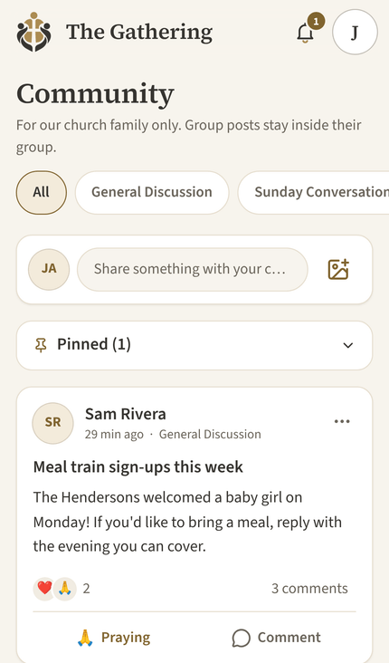
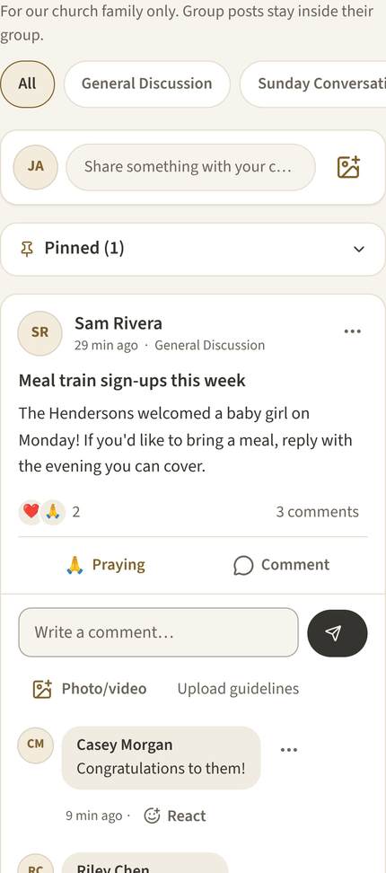
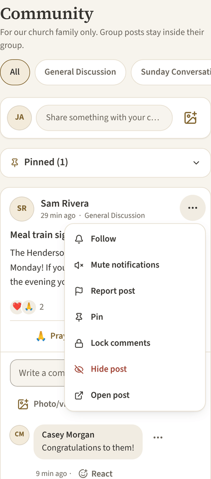
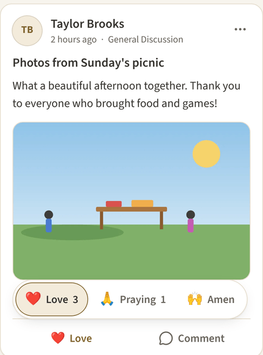
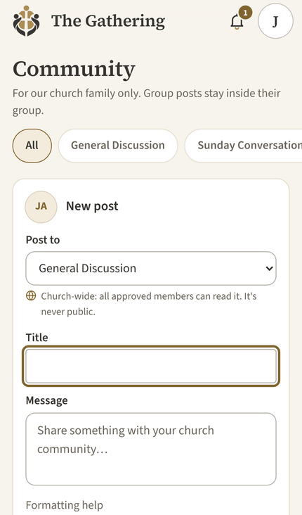
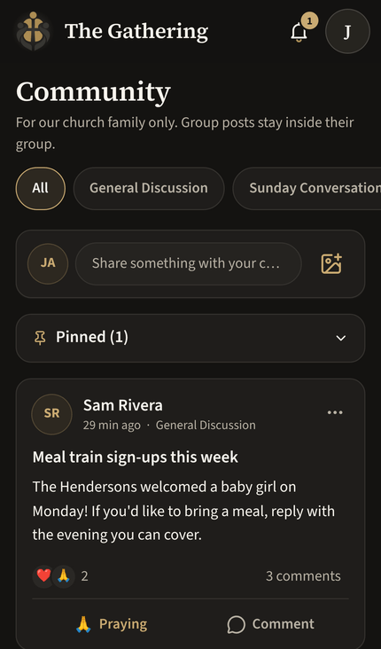

# Community feed

Community opens to a feed of original posts. Comments stay closed until a member opens them. This page describes how the feed behaves and what has to happen before it ships.

## What members see

- **Feed.** Original posts only, newest first, ordered by when each was posted. Comments, reactions and edits never move a post. The filter row covers **All**, each church-wide category, and each of the member's groups. Old category links (`/community/c/<id>`) go to the matching filter.
- **Composer.** A one-line "Share something with your church community…" bar. Opening it shows where the post goes (a category or one of the member's groups, with who can read it), a title, the message and photos or videos. After posting, the member returns to the same feed with the new post at the top.
- **Post card.** Author, time, place, and a ⋯ menu. Then the title, the text (long posts get **See more**, which expands in place) and media. Below that, a reaction summary (zero counts hidden), the comment count, and **React** and **Comment** buttons.
- **Comments.** They open under the post, newest first, with the comment box at the top. **Load older comments** continues from a cursor. A new comment appears at the top and the count updates without reloading. **Hide comments** collapses them but keeps any draft and chosen files. Leaving the page with an unsent draft asks first.
- **Reactions.** Love, Praying and Amen, with the same rules as before: each is its own toggle, so a member may choose more than one. The picker opens by tap, click or keyboard (Escape closes it). Nothing depends on hover or long press.
- **Menus.** Post: Follow, Mute, Edit, Delete, Report, Pin, Lock, Hide/Restore, and Open post. Comment: Edit, Delete, Report, Hide/Restore. Each item appears only when the database says the member may use it, and every action is checked again on the server. Destructive actions still ask for confirmation. Hide asks for a reason.
- **Pinned posts** keep their normal place in the newest-first feed and are also listed in a small collapsible **Pinned** section.
- **New posts.** These never move the page. A "N new posts" button appears instead, and the feed reloads only when the member taps it.
- **Permalinks.** `/community/t/<id>` shows the same card with comments open. Notification links add `?comment=<id>`, which loads far enough back to reveal and focus that comment, even an old one. Deleted, hidden or inaccessible posts and comments show a plain "isn't available" message.
- **Back to the feed.** Going Back from a post (browser Back or the Community link) restores the same posts and scroll position.
- **Avatars** use initials only. Member photos follow directory privacy settings, so the feed doesn't show them.

## Data and access (migration `20261101000100_community_feed.sql`)

The migration is additive. It adds three indexes and these functions:

| Function | Purpose |
| --- | --- |
| `community_feed(category, group, cursor_at, cursor_id, limit)` | Feed page, `created_at desc, id desc`, cursor `(created_at, id)`; first page also lists pinned posts |
| `community_feed_post(id)` | One post as a feed card (permalink, refresh after an action) |
| `community_feed_newer(category, group, at, id)` | Count of newer posts for the "new posts" button |
| `community_comments(thread, cursor_at, cursor_id, limit, through)` | Comments newest first; `through` extends the page to a linked comment (max 500) |

It also replaces `community_notification_open`. The checks and URL are unchanged, except reply notifications now append `?comment=<reply id>`.

Access rules are the existing ones:

- Approved adult members only (`community.require_member`), so pending, suspended and youth accounts are refused. Youth discussions live in their own schema and never appear here.
- Group posts are only visible to current group members.
- Hidden posts and comments are only visible to people who can moderate them.
- Deleted posts and comments are left out.
- Photos and videos still go through `community.attachment_visible` and the access-checked file route.

Comment counts use the same rule, so a hidden reply never shows up in a member's count.

**One change in what members see:** comments that were deleted or hidden used to appear as "deleted" / "Removed by a moderator" placeholders. In the comment list they are now left out. Moderators still see hidden comments, marked as hidden.

## Before merging

1. Apply `20261101000100_community_feed.sql` to the hosted project. The new Community page calls these functions, so it shows "couldn't be loaded" until the migration exists. Merge only after the migration is applied, or apply it in the same release window.
2. After applying, run the schema and community fingerprint checks (`supabase/tests/schema-fingerprint.sql`, `community-fingerprint.sql`) and compare them with a fresh local build.

## Screenshots (synthetic data)

| Phone | Phone, comments open | Phone, menu | Phone, reactions |
| --- | --- | --- | --- |
|  |  |  |  |

| Phone, composer | Phone, dark |
| --- | --- |
|  |  |

Desktop: [light](community-feed/desktop-light-feed.png), [dark](community-feed/desktop-dark-feed.png).
