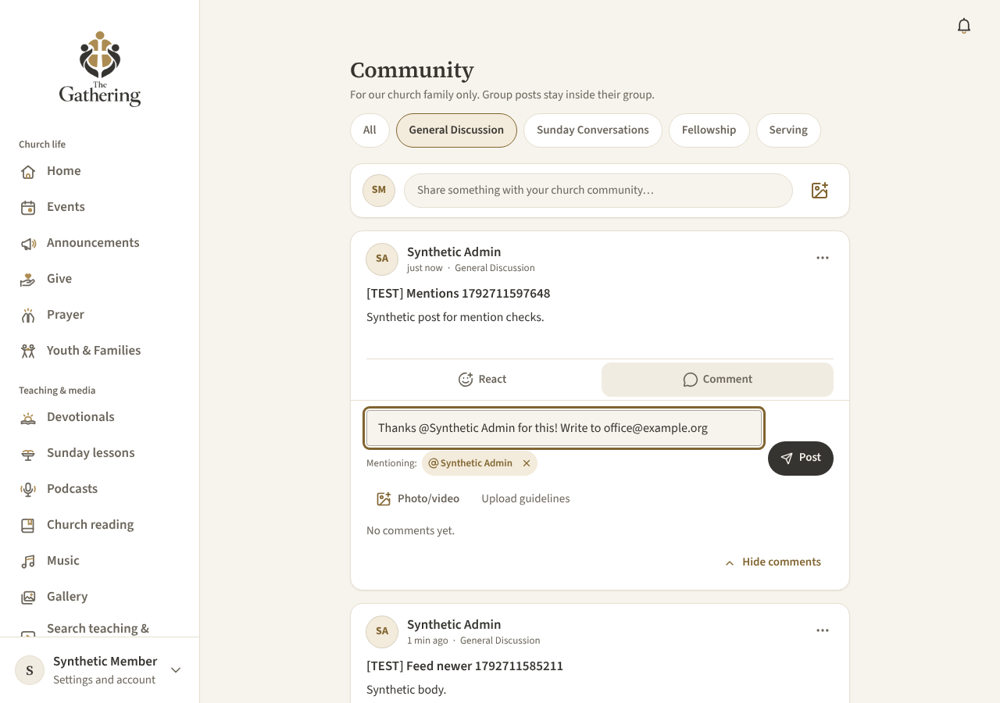
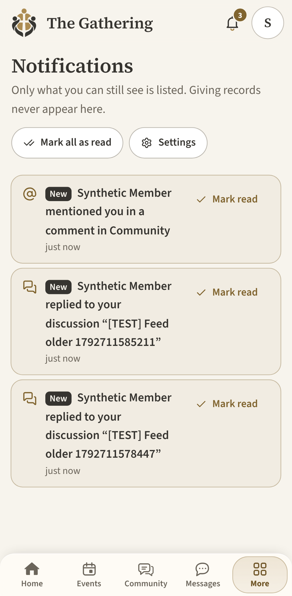
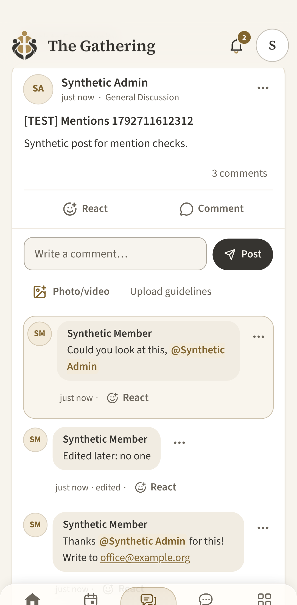
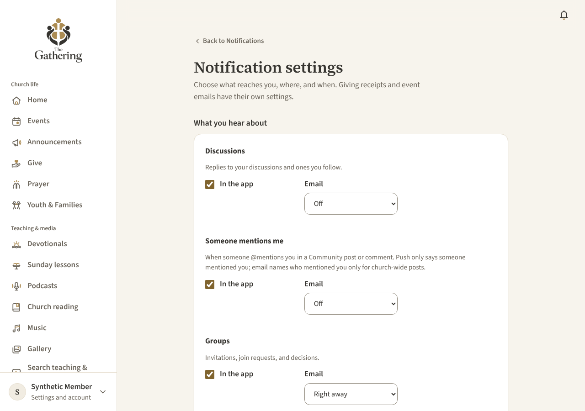

# @mentions in Community

Members can tag each other in Community posts and comments. This page covers what members see, who can be mentioned, how mentions are stored and notified, and what has to happen before the feature ships.

## What members see

- **Suggestions.** In the new-post box, the full-page post and edit forms, the comment box and the comment edit box, typing `@` and part of a name opens a list of people who can be mentioned in that post (at most 8). Each row shows the member's directory name, their photo if they share it in the directory (otherwise initials), and their city if they share it. That city is how two people with the same name are told apart; nothing else is shown.
- **Choosing.** Use the arrow keys, then Enter or Tab. Escape closes the list. On a phone, tap a name. The list never steals focus from the text box. Pressing Enter before the list appears types a new line, as usual.
- **Editing.** The box shows plain names (`@Ann Rivers`). The people you mentioned are listed under it ("Mentioning: Ann Rivers ×"). Remove one with its × or with Backspace: deleting into a name removes the whole mention. Typing inside a name turns it back into plain text.
- **What isn't a mention.** Only a name picked from the list becomes a mention. Email addresses (`office@example.org`), a hand-typed `@ben`, `@everyone` and `@all` stay plain text. There's no way to mention a group or everyone.
- **Reading.** A mention shows as `@Name` in Gathering's link style, using the member's current name. It links to their directory entry only if they're listed in the directory; otherwise it's plain text. If the member can't be shown any more (suspended or deleted), the name as originally written is shown as plain text.
- **Limit.** Up to 10 different people per post or comment.

Screenshots (synthetic data, local stack): [docs/community-mentions/](community-mentions/).

| Phone, suggestions | Same name, different cities | Phone, tap to choose | Rendered |
| --- | --- | --- | --- |
|  |  |  |  |

| Composer with a mention | Notification | Comment revealed | Settings |
| --- | --- | --- | --- |
|  |  |  |  |

## Who can be mentioned

Suggestions and saves use the same rule (`community.can_mention`), checked in the database:

- an approved **adult** member who is **listed in the directory**. Pending, suspended, youth and opted-out accounts are never suggested or saved. Youth accounts can't use Community at all, so this adds no adult-to-youth tagging;
- who can **read the post**: anyone like that for a church-wide post, or only **current members of the group** for a group post. A mention never gives anyone access to a post or group;
- with **no block** in either direction between them and the author.

Search runs on the server (`community_mention_search`), returns at most 8 people, and is rate-limited (300 per 10 minutes per member). It returns only a name, a photo path if the member shares their photo (signed URLs are issued through storage rules, which check again), and a city if shared. It never returns an email address, phone number or any hidden field. The directory itself is never downloaded.

## Storage and validation (migration `20261107000100_community_mentions.sql`)

- **Text.** A mention is saved in the post or comment text as `@[Display name](mention:<member id>)`. The id is what counts; the name is only a fallback label. Older app versions render this as plain `@Display name` text. Excerpts (`thread_card`) show `@Name`.
- **Validation on save.** Triggers on `community.threads` and `community.posts` run in the same transaction as every save path: create, create with photos or videos, edit, and author delete. Markup for anyone who can't be mentioned there (a forged or random id, an opted-out, pending, suspended or youth account, someone outside the group, or someone blocked) is turned back into plain `@Name` text before the row is written. More than 10 people is refused with a clear message. A failed save leaves nothing behind.
- **Records.** `community.mentions` has one row per post or comment and member, keyed by member id. `removed_at` is set when an edit removes a mention and cleared if it's added back. `notified_at` is set once a notice was attempted.
- **Rendering.** `community_feed`, `community_feed_post` and `community_comments` return `mentions: [{ id, name, listed }]` for each post and comment. The app's Markdown renderer (`renderCommunityText(body, { mentions })`) turns only that markup into `@Name`, escaped. It's a link to `/directory/<id>` only when `listed` is true. Raw HTML is still escaped and other formatting is unchanged. Photo and video attachments are unaffected.

## Notifications

New kind `mention` in a new category `mentions` (**Someone mentions me** under Notifications → Settings). Defaults: in the app on, email off, push off. Email can be Off or Right away (no digests).

- **Wording:** "Rob Webb mentioned you in Community", "… in a comment in Community", or "… in <group name>" for group posts. The link opens the post. For a comment, `/notifications/open/<id>` adds `?comment=<id>`, so the existing feed behaviour expands, reveals and focuses that comment.
- **Once per person per post or comment.** Nobody is notified for mentioning themselves. A retried submit with the same client key saves nothing new. Re-saving unchanged mentions doesn't notify again. Newly added people are notified once. Removing someone and adding them back never notifies them a second time. Only visible content triggers a notice.
- **No double notices.** When a reply mentions the post's author or a follower, they get the mention notice instead of the reply notice for that comment (`community.notify` skips `reply_mine`/`reply_followed` there).
- **Rechecked on every read and every email or push claim** (`notification_visible`): the mention is still in the text, the post and comment are visible, the member can still read the post (for example, they're still in the group), and they haven't blocked the author. If any check fails, the notice disappears and any queued email or push is marked `skipped`. The existing rules (blocks, mutes, quiet hours, preferences, merge keys, outboxes, one designated scheduler) apply unchanged.
- **Outside the app:** push is always generic ("Someone mentioned you in Community."). Email names who mentioned you only for church-wide posts, like reply emails. For group posts it says only "You were mentioned in a <group> group discussion". Both link to `/notifications/open/<id>`, which rechecks access first.
- **Rate limit:** at most 50 new mention notices per author per hour (`community.rate_limit`), on top of the existing post, comment and edit limits.

Decision for the owner: email defaults to **off**, like Discussions, so turning on mentions doesn't start emailing members. Change the `'mentions'` default in `community.pref` if you'd rather email right away.

## Verification

- `tests/db/community-mentions.test.ts` (19 tests, PostgreSQL 16 built from every migration) covers:
  - suggestions: who's included and excluded, duplicate names, group limits, bounded results;
  - post and comment mentions; forged and ineligible ids; group restrictions; the 10-person limit; no `@everyone`;
  - reply overlap; retries; edits with add, remove and re-add;
  - failed saves; formatting and video attachments;
  - current names and directory links; hidden and deleted content dropping notices and queued email and push;
  - generic push and group-safe email text; losing group access; blocks; suspension; settings and the panel filter.
- `src/lib/community/mentions.test.ts` and `format.test.ts` test markup round-trips, the caret and edit logic, email addresses, and safe rendering.
- `tests/e2e-local/08-community-mentions.spec.ts` is a signed-in walkthrough on desktop and Pixel 7 against a local Supabase stack. It covers keyboard choice, tap choice, duplicate names, opted-out members, email addresses, Backspace and chip removal, editing a posted comment, opening the notification with the comment revealed, settings, and an axe check. Set `MENTION_SHOTS=<folder>` to save screenshots.

All people and notification destinations in these tests are synthetic. Email and push are only claimed in tests and never sent.

## Release

- **Merged:** #44 on 2026-10-22, deployed to production.
- **Hosted migration:** applied on 2026-10-22 with `supabase/manual/2026-11-07-apply-community-mentions.sql`. Both fingerprint checks match a fresh local build; see [migration-history.md](migration-history.md#community-mentions-2026-11-07).
