# @mentions in Community and Prayer

Members can tag people and groups in four places: Community posts, Community comments, prayer requests, and prayer comments. It's one system: the same composer, the same stored format, the same rules for who can be mentioned, and the same delivery and dedupe. Community and Prayer each keep their own access rules.

This page covers what members see, the group setting for leaders, members' notification settings, the privacy rules, how mentions are stored and notified, how it was verified, and how to release it.

- People in Community posts and comments shipped in #44 (migration `20261107000100`).
- Groups everywhere, and people and groups in Prayer, are added by migration `20261108000100_mentions_groups_prayer.sql` (this change).

## What members see

- **Suggestions.** In the new-post box, the full-page post and edit forms, the comment and comment-edit boxes, the prayer request form, and the prayer comment and comment-edit boxes, typing `@` and part of a name opens a list in two sections:
  - **Members** (at most 8): the directory name, their photo if they share it in the directory (otherwise initials), and their city if they share it. The city is how two people with the same name are told apart; nothing else is shown.
  - **Groups** (at most 5): the group's name and image, a **Group** label, and either "Notifies N people" or "Mention without notifying".
- **Choosing.** Arrow keys, then Enter or Tab. Escape closes the list. On a phone, tap a row (rows are at least 44 px tall). Focus stays in the text box. The list opens above the box when the on-screen keyboard or the bottom navigation would cover it, and it never scrolls the page sideways.
- **Editing.** The box shows plain names (`@Ann Rivers`, `@Worship Team`). Chosen people and groups are listed under it ("Mentioning: …", groups with a group icon), each with a remove button. Backspace into a name removes the whole mention, and typing inside a name turns it back into plain text. Formatting, drafts kept in the form after a failed save, and photo and video attachments work as before.
- **What a group mention will do.** Under the box, each chosen group gets one line: "Notifies 12 people in Worship Team who can see this." or "Worship Team is mentioned without notifying anyone: only its leaders and moderators can notify the group." (or: only its members can, the group turned notifications off, or groups aren't notified from anonymous posts). Nothing is sent to a whole group without this line saying so first.
- **What isn't a mention.** Only something picked from the list. Email addresses (`office@example.org`), a hand-typed `@ben`, `@everyone`, and `@all` stay plain text. There are no mass mentions.
- **Reading.** Mentions show as `@Name` with a soft Gathering accent, using the current name. A person links to their directory entry only if they're listed; a group links to its page (with a small group icon and "(group)" for screen readers) only if the reader may see that group. Otherwise it's a label that can't be clicked. Someone who can't be shown any more (suspended, deleted) is plain text with the name as written. A group the reader can't see (hidden, or archived and they aren't in it) shows only as "@Group".
- **Limits.** Up to 10 people and 3 groups per post, request, or comment. The group limit is a church setting (`community.settings.group_mention_limit`, 1–10).
- **Mistakes are explained.** If a save includes someone or a group that can't be mentioned there (they left the group, the audience changed, or the id was forged), nothing is saved and the message names them: "@Ben Rowe can't be mentioned here. You can mention only members who can already see this post; a mention never shares it with anyone else. Remove the mention and try again." The text stays in the box. (Before this change, such mentions were quietly turned into plain text.)

### Prayer

- The request's audience stays in view under the text ("Seen by church members." / "Seen by Worship Team."), with a reminder that mentioning someone lets them know about the request, doesn't share it with anyone else, and doesn't say the request is about them. Prayer comments say who they're seen by the same way.
- Mentions never change the audience. If you change the audience after choosing mentions, the form checks them and explains anything that wouldn't fit, with a **Remove** button for each, before you can save ("@Cara Lane can't see a request shared with Worship Team, so they can't be mentioned."). The server checks again and refuses; nothing is ever widened to make a mention fit.
- **Confidential (prayer team) requests** take no mentions, so team membership is never probed and the care team's boundary is unchanged. **Private drafts** aren't checked or notified; mentions are checked, recorded, and sent only when the draft is shared.
- **Anonymous requests** (and the requester's anonymous comments): mentioned people are told "You were mentioned in a prayer request", with no name anywhere. Groups can be referenced but are never notified from anonymous content, since "a leader of this group wrote it" would narrow down who. Suggestions are based on the request's audience only, never on the writer's own access, so they can't single out the writer.

Screenshots of #44 (synthetic data, local stack): [docs/community-mentions/](community-mentions/). Screenshots for groups and Prayer (synthetic data, local stack): [docs/community-mentions/groups-prayer/](community-mentions/groups-prayer/).

| Group suggestions | Phone, tap a group | Reference only | Group setting |
| --- | --- | --- | --- |
| 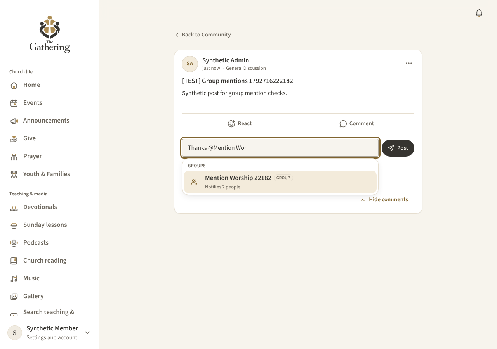 | 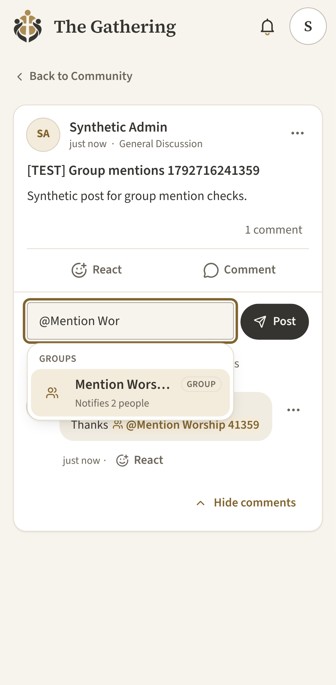 | 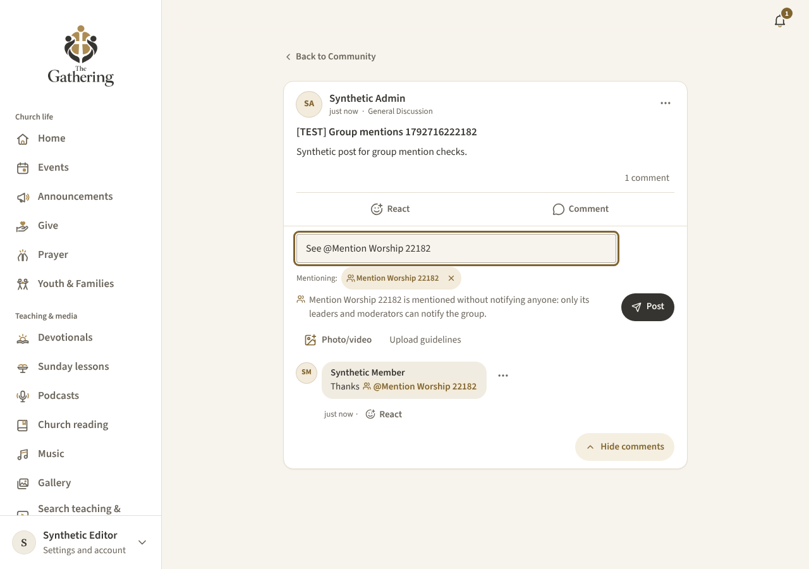 | 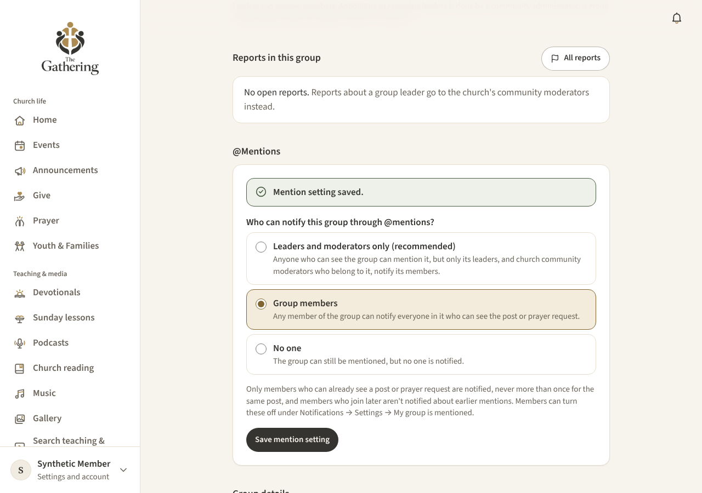 |

| Prayer composer | Audience change explained | Prayer comment revealed | Settings |
| --- | --- | --- | --- |
| 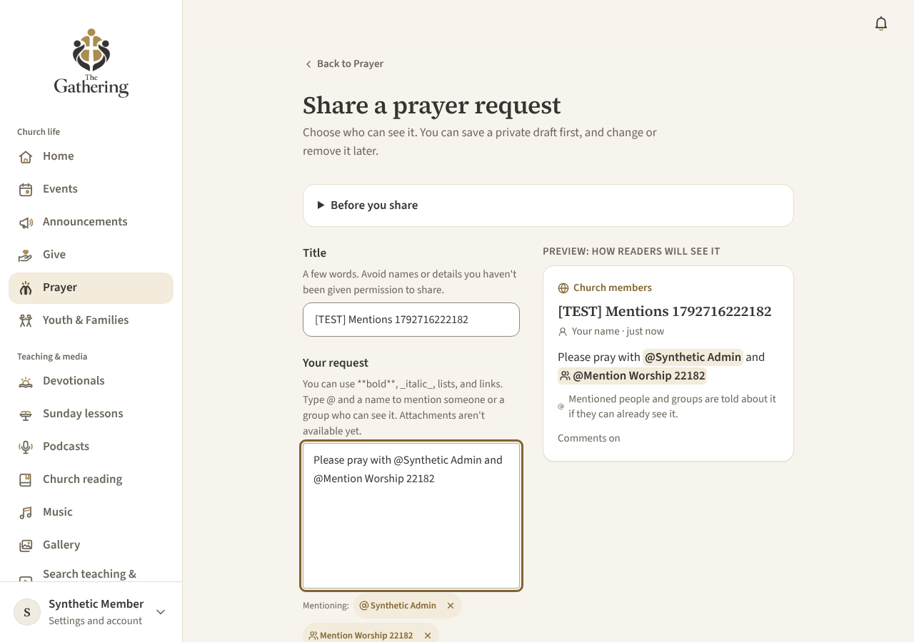 | 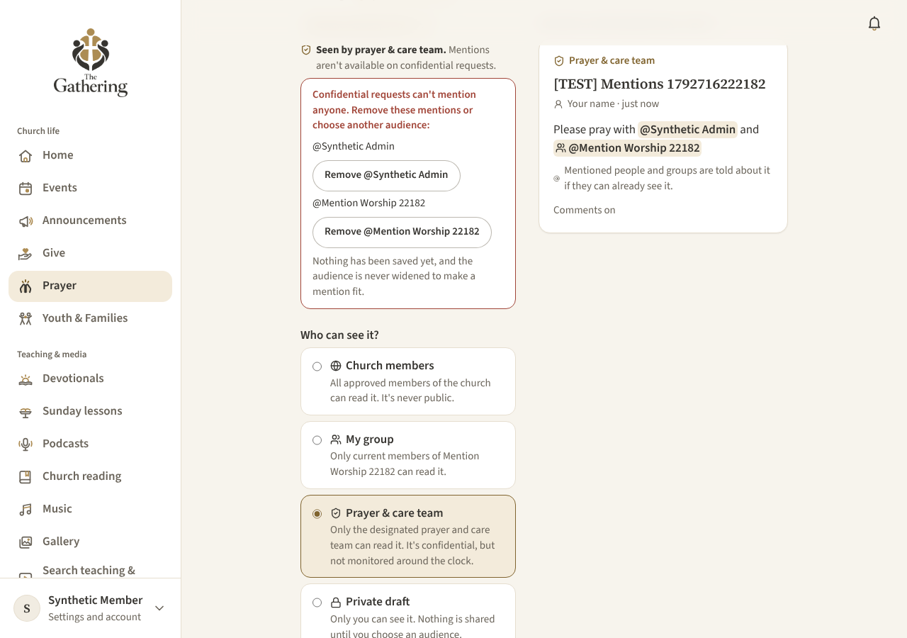 | 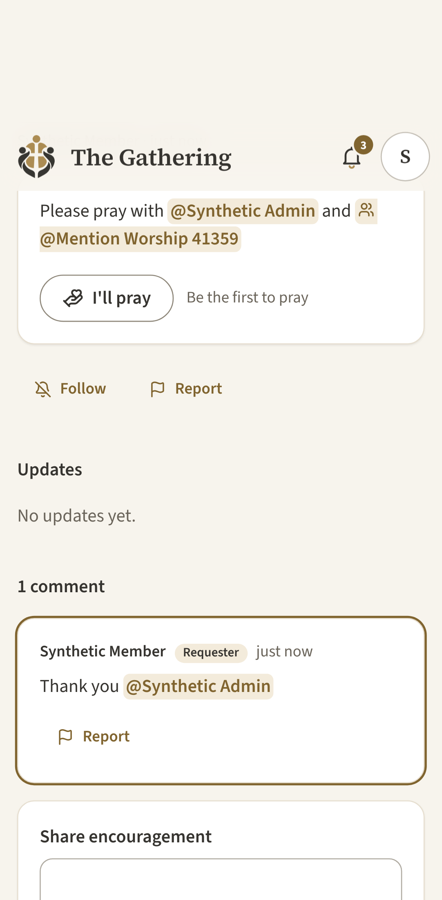 | 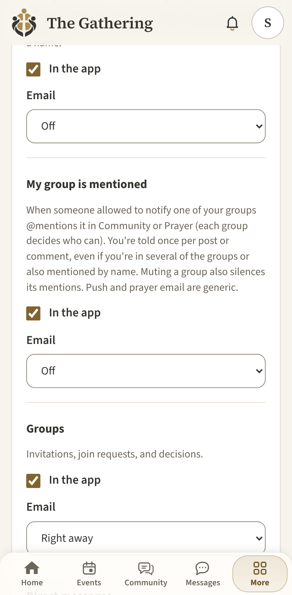 |

| Phone, suggestions | Same name, different cities | Phone, tap to choose | Rendered |
| --- | --- | --- | --- |
| 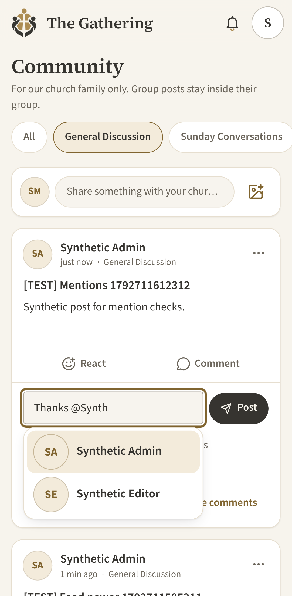 | 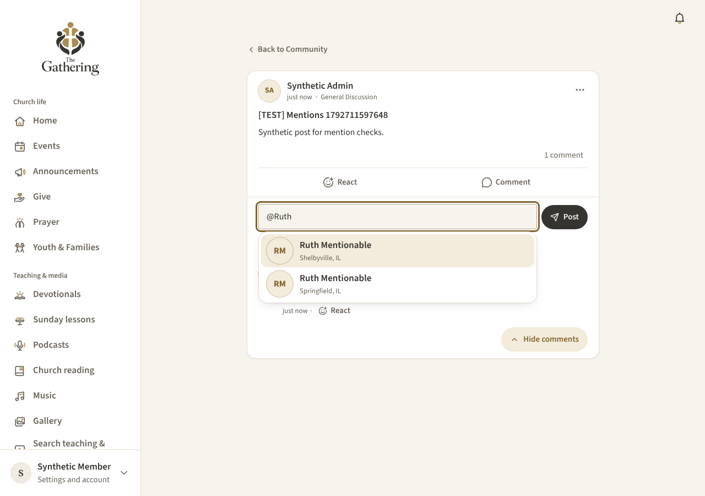 | 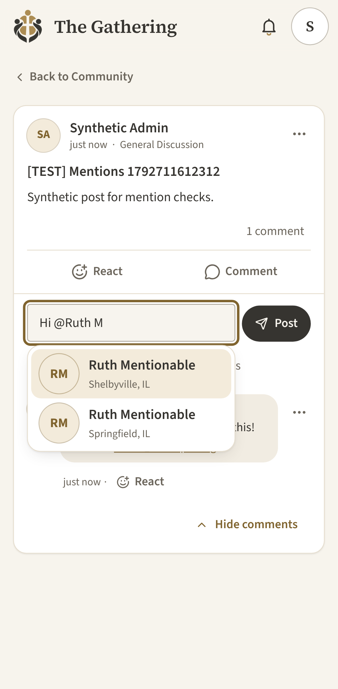 | 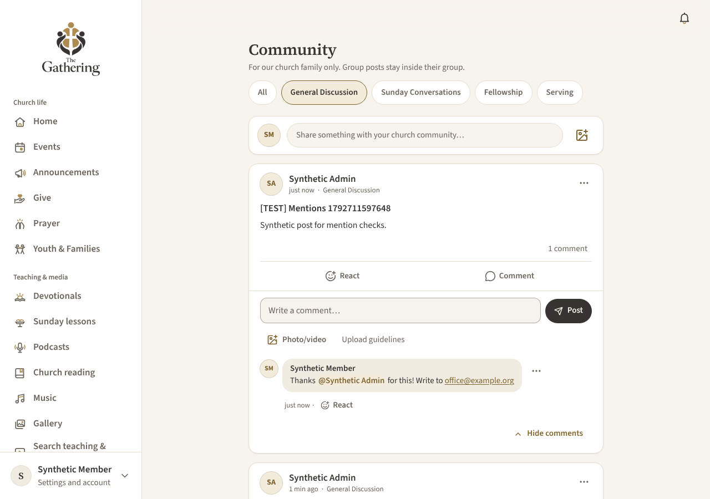 |

## Group controls (for group leaders)

**Groups → your group → Manage → @Mentions: "Who can notify this group through @mentions?"**

| Option | Who notifies the group's members |
| --- | --- |
| **Leaders and moderators only** (default for every group, including existing ones) | The group's leaders, and church community moderators who belong to the group |
| **Group members** | Any active member of the group |
| **No one** | Nobody. The group can still be mentioned as a link. |

- Only the group's leaders and community administrators can change it. The database enforces it on every save, and every change is recorded in the audit log (`group.mention_notify_changed`, from and to).
- **Referencing vs notifying.** Anyone can *mention* a group that's listed in the group directory, which just links to it. A hidden group can be mentioned only inside that group (a post in the group, or a prayer request shared with it), so its name never reaches people outside it. *Notifying* its members is what this setting controls.
- **Who is notified:** active, approved members of the group who can already see the post or request (for a post in another group, or a prayer request shared with another group, only people in both), captured when the mention is saved. Never the author, anyone blocked either way, or anyone who muted the group. People who join later never get older mention alerts. Each person is told once per post or comment, however many of their groups are mentioned, and not again if the mention is edited, removed, or added back.
- Group mention fan-out is rate-limited (20 group notifications per author per hour) on top of the 50 personal mention notices per hour.

## Notification settings (for members)

**Notifications → Settings** has two mention rows:

| Setting | When | Defaults |
| --- | --- | --- |
| **Someone mentions me** (`mentions`) | You're mentioned by name in a Community post or comment, or a prayer request or prayer comment you can already see | In app on; email Off; push off |
| **My group is mentioned** (`group_mentions`) | One of your groups is mentioned by someone allowed to notify it | In app on; email Off; push off |

Email for both is Off or Right away (no digests). Turning these on for existing members is never done for them: existing settings are kept and the new row starts at its defaults.

**Precedence, applied the same way everywhere:**

1. **Blocks** win: nothing from someone you've blocked (or who blocked you).
2. **Mutes**: a muted discussion silences mentions in it; a muted group silences mentions of that group, and mentions in its discussions.
3. **The mention rows decide the channels** (app, email, push) for mention alerts in both Community and Prayer, instead of the Discussions or Prayer rows. So Prayer email off doesn't silence a direct mention, and "Someone mentions me" off silences mentions everywhere. If you're mentioned by name *and* through a group, the "Someone mentions me" row applies (you get one notice).
4. **Quiet hours** hold email and push until they end; the notice still appears in the app.
5. A mention in a reply replaces the reply or "new comment" notice for the same comment, so you hear about it once.

Wording:

| Where | In the app | Email | Push |
| --- | --- | --- | --- |
| Community, you | Rob Webb mentioned you in Community / in a comment in Community / in Worship Team | Same for church-wide posts; "You were mentioned in a Worship Team group discussion" for group posts | Someone mentioned you in Community. |
| Community, your group | Rob Webb mentioned your group, Worship Team, in Community (or in a comment) | Same for church-wide posts; "Your group was mentioned in a … group discussion" for group posts | Your group was mentioned in Community. |
| Prayer, you | You were mentioned in a prayer request: "Title" (or in a comment on a prayer request) | You were mentioned in a prayer request (no title, no names) | You were mentioned in a prayer request. |
| Prayer, your group | Your group, Worship Team, was mentioned in a prayer request: "Title" | Your group was mentioned in a prayer request | Your group was mentioned in a prayer request. |

Prayer mention notices never name who wrote them. The bell panel shows them only as "Prayer mention". Email and push link to `/notifications/open/<id>`, which rechecks access before opening anything.

**Opening a notice:** a post mention opens the post; a comment mention opens the post with comments expanded and the comment revealed and focused; a prayer mention opens the request; a prayer-comment mention opens the request with enough of the conversation loaded to show that comment (even if it's one of the older ones) and moves focus to it. Back navigation is unchanged. If the content was deleted, hidden, or is no longer yours to see, you get the usual "no longer available" state.

## Who can be mentioned

The same rule decides suggestions, saves, and delivery, checked in the database:

- **People:** an approved **adult** member who is **listed in the directory** (pending, suspended, youth, and opted-out accounts never), who can **already read** the content (anyone such for church-wide posts and church-wide prayer requests; only current members of the group for group posts and group prayer requests), with **no block** either way. A mention never grants access to anything.
- **Groups:** active groups listed in the group directory, or the content's own (possibly hidden) group for its members.
- **Youth:** youth accounts can't be mentioned, can't be notified (group notices go only to approved adults), and groups here are adult community groups; supervised youth groups are separate and untouched. No new adult-to-youth contact is possible.

Search runs on the server (`community_mention_suggest`, `prayer_mention_suggest`), is bounded (8 people, 5 groups), and rate-limited (300 per 10 minutes per member). It never returns email addresses, phone numbers, hidden profile fields, rosters, or member counts the author couldn't see anyway (a count is shown only when the author can notify the group, which means they're in it). The directory and group rosters are never sent to the browser.

## Storage and validation

- **Text.** `@[Display name](mention:<member id>)` and `@[Group name](group:<group id>)`. The id is what counts; the name is only a fallback label. Older app versions show both as plain `@Name` text. Excerpts show `@Name`.
- **Validation on save.** Before-triggers on `community.threads`, `community.posts`, `prayer.requests` (body, audience, and group), and `prayer.comments` refuse ineligible or forged ids and over-limit saves, in the same transaction as every save path. A failed save leaves nothing behind.
- **Records.** `community.mentions` / `community.group_mentions` (Community) and `prayer.mentions` / `prayer.group_mentions` (Prayer), one row per content and person or group, with `removed_at` for edits. `community.mention_deliveries` has one row per content and person ever notified, which is the dedupe for overlap, retries, concurrent saves, and remove/re-add.
- **Rendering.** Feed, comment, and prayer functions return `mentions: [{ id, name, listed, kind? }]` for the reader. Group names the reader can't see are replaced with "Group" in the text itself. `renderCommunityText(body, { mentions })` turns only that markup into escaped HTML; raw HTML stays escaped.

## Delivery and cancellation

- Notices go through the existing `community.notify`, email outbox, and push outbox (quiet hours, blocks, mutes, preferences, merge keys, and the single designated scheduler).
- **Rechecked on every read and every email or push claim** (`notification_visible`): the person or group is still mentioned there, the content is visible and shared, the person can still read it (and was in the prayer comment's audience), they're still in the group for group notices, and they haven't blocked the author. Otherwise the notice disappears and anything queued is skipped.
- **Cancelled at once** too: removing a mention, hiding or deleting a post or comment, hiding, narrowing, or archiving a prayer request, hiding a prayer comment, leaving a group, or an account stopping being approved marks queued email and push for affected notices as skipped. Deleting a prayer request removes its notices.
- Nothing is sent for drafts, failed saves, unchanged mentions, or retried submits.

## Verification

All people, groups, posts, prayer requests, and notification destinations in tests are synthetic. Email and push are only claimed in tests, never sent.

- **Database** (PostgreSQL 16 built from every migration):
  - `tests/db/mentions-groups-prayer.test.ts` (24 tests) covers group suggestions and hidden groups; the group setting and who may change it; reference-only vs notifying; recipient capture (author, blocks, mutes, opt-out); overlap with a direct mention and overlapping groups; edits, remove/re-add, and joining later; retries and two concurrent saves; reply-notice replacement and comment links; forged, hidden, and too many groups; name redaction after a group is hidden; cancellation on leaving a group, removing a mention, and hiding; email and push wording; preferences and the panel filter; prayer suggestions per audience, confidential and draft requests; prayer people and group notices; anonymous requests (no names, no group notices, generic email); not singling out an anonymous writer; prayer comment links and positions; refusing an audience change that would break a mention; drafts; hiding, archiving, and deleting; youth, pending, and forged ids.
  - `tests/db/community-mentions.test.ts` (19 tests, from #44) updated for refusing ineligible mentions.
- **Unit:** `src/lib/community/mentions.test.ts`, `format.test.ts`, and `notification-preview.test.ts` cover group markup round-trips, rendering and escaping, links and labels, and the generic panel preview for prayer mentions.
- **Browser (local stack):** `tests/e2e-local/09-group-prayer-mentions.spec.ts` on desktop and Pixel 7: group suggestions and notices, reference-only for non-leaders, the group setting, the prayer composer (audience in view, confidential explained, sharing), prayer comment links revealing the comment, the list staying inside a phone viewport and tap selection, settings, and an axe check. `08-community-mentions.spec.ts` is updated for the new list name. Set `MENTION_SHOTS=<folder>` to save screenshots.
  - Result (local `supabase start` with every migration and the seed, production build, Chromium): spec 09 13 passed and 1 phone-only test skipped on desktop; spec 08 11 passed and 1 skipped. In a run of the whole walkthrough suite, the only failures were outside mentions: email templates and Google sign-in not configured on the local stack (01, 06), and three checks already out of date on `main` (02's "Report this discussion" button and 05's header notifications link moved into menus, 03's duplicate youth text). #44's comment-reveal check (08) sometimes loses focus on desktop when it runs right after other specs; it passes alone.
- **Not verified here:** hosted Supabase, physical phones (real on-screen keyboards, VoiceOver/TalkBack), and real email or push delivery.

## Release

Not merged, deployed, or applied to the hosted project. In order, with the owner's approval:

1. Review and merge the PR. The app is safe to deploy before the migration: Community member suggestions keep working; group and Prayer suggestions stay empty and the group setting stays hidden until the migration exists. (Saving a post with a group mention before the migration would store the markup as plain text.)
2. Apply the migration with `supabase/manual/2026-11-08-apply-mentions-groups-prayer.sql` in the SQL editor (one transaction; it refuses to run out of order or twice). See [migration-history.md](migration-history.md#mentions-groups-and-prayer-2026-11-08).
3. Decide whether to tell group leaders about the new @Mentions setting (it defaults to leaders and moderators only, so nobody gets group alerts until a leader uses it).

Decisions for the owner:
- Email for both mention rows defaults to **Off**, so the feature doesn't start emailing members. Change the defaults in `community.pref` if you'd rather email right away.
- The group limit defaults to **3** per post (`update community.settings set group_mention_limit = <1–10>;`).
