# Photo picker cancellation and image cropping

Choosing a photo anywhere in the app can now be cancelled at every step without losing anything. Photos open in one shared cropper before anything is uploaded or replaced. How a photo is framed depends on where it's shown.

This page covers the picker investigation, what changed on each screen, how framing is stored, phone image handling, verification, and how to release it. Migration: `20261110000100_media_cover_framing.sql` (applied to the hosted project; see [migration-history.md](migration-history.md#media-cover-framing-2026-11-10)).

## 1. Photo-picker cancellation

### What was found

The report: on a phone, Upload photo opens the photo library, and the member can't get out without choosing a photo.

- **Operating-system picker.** Every upload control is a standard `<input type="file">`. On iPhone it shows the system menu (Photo Library, Take Photo, Choose File), and the Photo Library sheet has its own **Cancel**. Android's photo picker has a close (×) and Back. The app doesn't draw or control these screens and can't add buttons to them. No app overlay sits on top of them.
- **App-controlled steps.** These were the real problems:
  - **Profile photo:** after choosing a photo, the page had no way to discard it. The only ways out were saving it or choosing a different photo. This matches "can't exit without selecting an image". Choosing the same file again also did nothing, because the field still held it.
  - **Dismissing the picker:** some browsers (older Chrome and Android WebViews) send an empty change when the picker is cancelled. The profile form treated that as "no photo" and threw away the photo already being positioned.
  - **Cover library picker (full-screen on phones):** its header with the close button had no safe-area padding, so in the installed app in landscape the notch could cover it.
  - **Plain image fields** (event, banner, announcement, campaign, Bible plan, group): a form that reset after a failed save could lose the chosen file without any message.
- **Stuck state:** no spinner or overlay stayed behind after a cancel. All upload states return to idle.

### What changed

- Dismissing the system picker never changes anything. An empty change or a `cancel` event is ignored. If the browser emptied the field, the chosen file is put back.
- After choosing, the photo opens in the app's cropper. It has visible **Cancel** and close (×) buttons, and Escape works. Cancel always returns to the form with every field, attachment, and the current image unchanged.
- File fields are cleared after their file is read, so the same file can be chosen again straight away.
- The cropper and the cover library picker respect safe areas (notch, home indicator, landscape sides). Cancel and Apply sit in a footer that stays on screen at any phone size.

**Limitation (operating-system picker):** if the system picker itself won't close, that's outside the app. On iPhone use **Cancel** at the top left of Photo Library, or swipe the sheet down. On Android use × or Back. We couldn't test on a physical iPhone or Android device (see Verification), so please re-test the original report on the reporter's phone. If it still happens *inside* the system picker, note the iOS version and whether it's Safari or the home-screen app.

## 2. The shared cropper

`src/components/media/image-cropper.tsx`. It's a native modal `<dialog>`: full-screen on phones, centred on larger screens. Focus moves in, stays in, and returns to where it was. It has:

- **Move:** drag with a finger, mouse, or pen.
- **Zoom:** pinch, scroll or trackpad pinch, a labelled slider, and − / + buttons.
- **Keyboard:** focus the photo, then use the arrow keys (Shift for bigger steps), + / − to zoom, and 0 to reset. Changes are announced.
- **Buttons:** Reset, Cancel, and Apply / Use photo.
- **Exact frame:** the frame is exactly what will be shown, with a circle for profile photos. The photo always fills the frame, so there are never empty edges.
- **Shape choice and previews:** where it applies, a shape choice, plus small previews of other places the image appears (for example, square cards).
- **Themes:** Light, Dark, and System all work, through the app's colour tokens.

### Shapes by destination

| Where | Frame | Stored as |
| --- | --- | --- |
| Profile photo | Square, circular preview (required) | Cropped 768 px copy, made on the device. The original never leaves the phone (existing privacy design). |
| Community posts and comments, gallery | **Whole photo by default**; optional Square, 4:3, 3:4, 16:9 | The whole original, or a cropped copy (at most 4096 px). Cropping again always starts from the original. |
| Lesson, devotional, and episode covers (media library) | 16:9, with a square card preview | The original in the media library, plus a **framing for this item only** |
| Series covers | 16:9, with series page (5:2) and card previews | The original, plus a framing for this series only |
| Book covers | **Whole cover by default** (portrait, never cropped to landscape); optionally "Fill square cards" | The original, plus an optional framing for cards |
| Home "Coming up" banner | Phone 3:1 and desktop 4.5:1: a focal point that both keep in view (no zoom, because the frame changes with the screen) | The existing focal point (`focus_x`, `focus_y`) |
| Event (16:9), announcement (16:9), campaign (16:7), Bible plan (16:9), group (square) images | Their display ratio, or Whole image | A cropped copy (or the whole original) through each form's existing upload and checks. These images belong to one item each. |

Videos are never cropped.

## 3. Originals and per-use framing

- **Media library images stay whole.** Covers upload the original through the existing library pipeline: rights, metadata removal, and size checks. Repositioning a cover stores a framing on **that item or series** (`media.items.cover_framing`, `media.series.cover_framing`). The library image and every other place that uses it are unchanged. Two lessons can use one image framed differently.
- **Framing** is `{x, y, zoom}`. `x` and `y` (0–100) mean what CSS `object-position` means for a covering image, and `zoom` (1–4) enlarges around that same point. The same values drive the cropper preview, every saved display (`framingStyle`), and canvas output (`visibleRect`) in `src/lib/media/framing.ts`. That's why the preview matches what is saved. Frames of a different shape (a square card vs a 16:9 highlight vs the 5:2 series page) keep the chosen point in view as closely as they can.
- `null` means centred, which is exactly the look before this change. For books, `null` means the whole cover. No existing row changes.
- **Edit later:** covers have **Reposition** (**Position cover** for books), which opens the current library image. Nothing is uploaded. Forms that store cropped copies (profile, discussions, gallery, and the per-item image fields) offer **Edit crop** from the original until the form is saved. After that, choose the photo again to crop it differently.
- **Changing the cover image clears its framing** (a database trigger), because a position belongs to one image. That includes replacing a library image with a new version.
- **Server checks:** `media_admin_cover_framing_save(p_item, p_series, p_cover, p_framing)` uses the same permission rules as saving: content editors, and only publishers once an item is scheduled, published, or archived. It validates the values and stores nothing if the saved cover is a different image. Every change is audited. Check constraints also guard direct writes.

## 4. Phone image handling

- **Orientation:** the browser applies the camera orientation (EXIF), so rotated phone photos open upright. The server still applies orientation again (`sharp().rotate()`).
- **HEIC:** an iPhone usually hands the browser a JPEG when the field doesn't list HEIC, and Safari can show HEIC itself. Browsers that can't show HEIC (Chrome or Firefox on Windows or Android) skip cropping with a short explanation, and the photo uploads whole. The server already converts HEIC for the gallery and discussions.
- **Large photos:** photos are decoded once and scaled to at most 4096 px on the longer side while editing (the iPhone canvas limit). Temporary canvases are released immediately, and object URLs are revoked.
- **Unchanged:** file-size limits, type checks, minimum dimensions, metadata removal, moderation, and upload permissions. Every upload still goes through the same server code.
- **States:** "Opening the photo…", "Preparing…", the existing upload progress and processing messages, and clear failures with **Try again**.
- **Never destructive early:** the current photo, cover, or banner is replaced only after the new one is confirmed and saved. A failed save keeps the chosen photo, its crop, and the rest of the form.

## 5. Verification

Everything below ran in this cloud environment. **No real phone was used**: the browser results are Chromium with device emulation (iPhone 13 size and touch, Pixel 7 size and touch, desktop), not Safari, not the installed home-screen app, and not a physical Android phone.

- **Unit (Vitest):** `src/lib/media/framing.test.ts`, 15 tests. Covers the framing maths (no empty areas for any image shape, frame shape, zoom, or position; zooming keeps the anchored point in place), parsing, and clamping.
- **Database (PostgreSQL 16, the real migrations):** `tests/db/cover-framing.test.ts`, 4 tests:
  - one image framed differently on two lessons and a series, with the library image unchanged;
  - members see the framing through `media_item` and `media_series`;
  - a cover change resets it, and a position for the old image is ignored;
  - invalid values, members, visitors, and editors on published content are refused, and publishers are allowed;
  - the direct-write constraint holds.
- **Operator script:** rehearsed on a local database built from every earlier migration. It applied, and a second run stopped at the preflight.
- **Browser walkthrough: 153 of 153 checks passed.** The real components ran on a temporary harness page (not committed), at iPhone 13 (light), Pixel 7 (System theme, phone in dark mode), and desktop. Server actions were redirected to stand-ins, because no Supabase stack could be started here: a synthetic library image, a refused upload, or no answer. Each size checked:
  - **Profile:**
    - dismissing the picker (empty change and `cancel` event) opens nothing and leaves the page usable, and choosing again right away works;
    - Cancel and Use photo are fully on screen, with a circular frame;
    - keyboard, slider, pinch (two touch pointers), drag, and Reset work;
    - Cancel and Escape keep the current photo, and focus returns to the file field;
    - the same file can be chosen again;
    - an EXIF-rotated photo opens upright;
    - the cropped copy is square and never enlarged;
    - Edit crop reopens at the chosen zoom, and cancelling an edit keeps the crop;
    - a refused save keeps the new photo and explains, with no stuck spinner;
    - Cancel new photo returns to the current photo;
    - a 48-megapixel JPEG opened and cropped in 3.3–5.6 s (emulated, so not a phone measurement).
  - **Discussion composer:**
    - title and message survive a dismissed picker and a cancelled crop;
    - the crop is optional with Whole photo first;
    - a cropped photo replaces the attachment in place.
  - **Gallery:**
    - a dismissed picker adds nothing;
    - a crop applies to one photo and keeps the captions;
    - Edit crop reopens on the chosen shape, and going back to the whole photo works;
    - a HEIC that Chromium can't show uploads whole, with an explanation.
  - **Lesson cover:**
    - Reposition stores the position for this item only and shows "Not saved yet";
    - a new image is positioned before upload, and Cancel uploads nothing;
    - a refused upload keeps the current cover and position and offers Try again.
  - **Book:** shows the whole cover by default, with "Whole cover" selected, and "Fill square cards" stores a position.
  - **Saved display:** the same image, framed differently on two lessons, renders differently, and the book card shows the whole cover.
  - **Banner:**
    - no zoom;
    - dragging moves the focal point;
    - cancelling a new image keeps the current banner, its position, and an empty file field.
  - **Campaign (plain file field):**
    - cancelling the first crop clears only the choice and keeps the form;
    - the form submits `…-cropped.jpg`;
    - a dismissed picker that empties the field puts the file back.
  - No page errors on any size.
- **Lint, typecheck, unit and database tests, and a production build** all pass (see the pull request).
- **Not done (needs the owner or a tester):**
  - a physical iPhone in Safari and the installed home-screen app, including the original report, a real HEIC photo, and a large photo's memory use;
  - a physical Android phone;
  - a signed-in walkthrough against a Supabase stack. Docker image pulls were rate-limited in this environment, so real uploads, storage, and the save actions weren't exercised end to end.
  - **Not changed:** the Scripture memory collection cover form (a server-rendered form). It still uploads the whole image.

| Profile: position (iPhone) | Profile: dark (Pixel 7) | New photo before saving | Refused save keeps it |
| --- | --- | --- | --- |
| 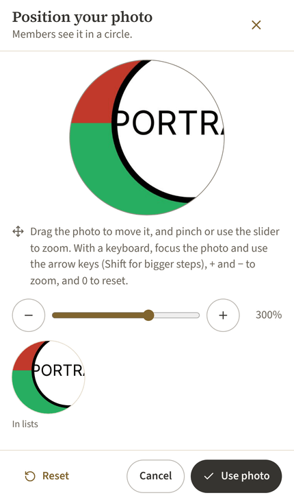 | 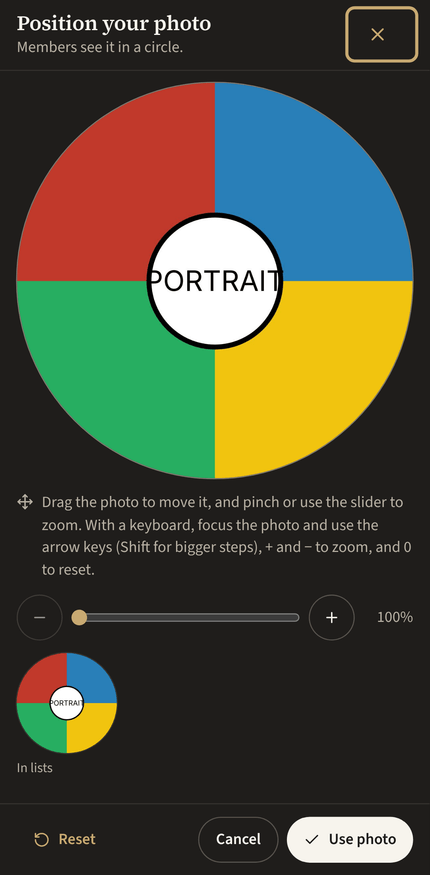 | 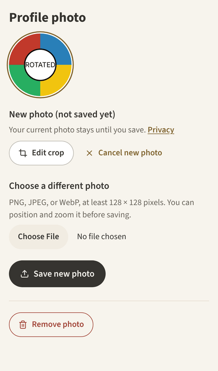 | 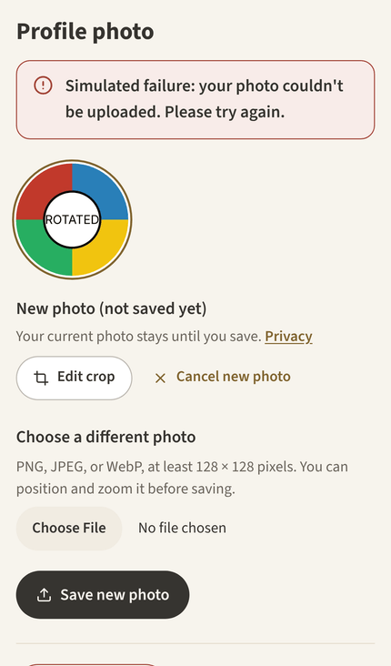 |

| Discussion: whole photo first | Optional square (dark) | Cropped in place | Gallery 4:3, rotated photo upright (dark) |
| --- | --- | --- | --- |
| 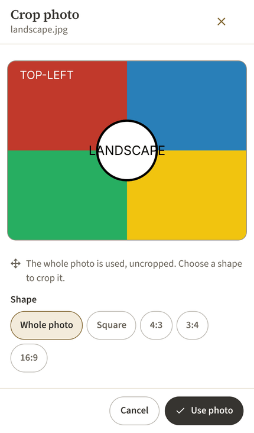 | 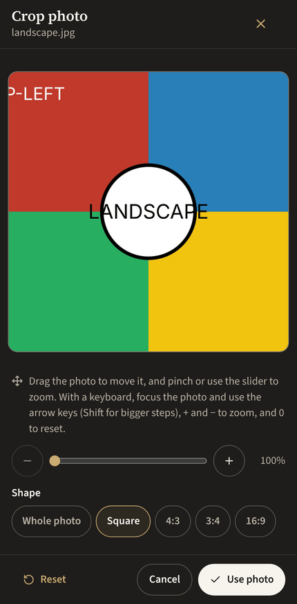 | 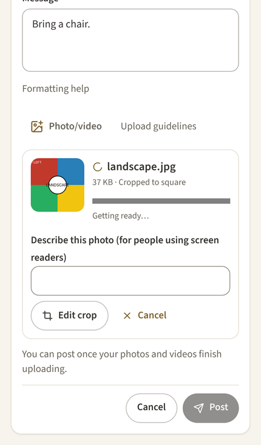 | 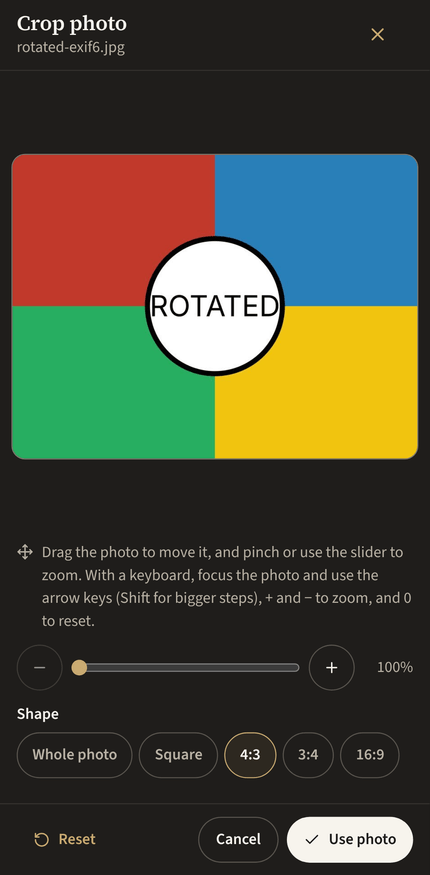 |

| Lesson cover: reposition | Upload refused, cover kept | Book: whole cover | Saved: one image, two lessons, a book |
| --- | --- | --- | --- |
| 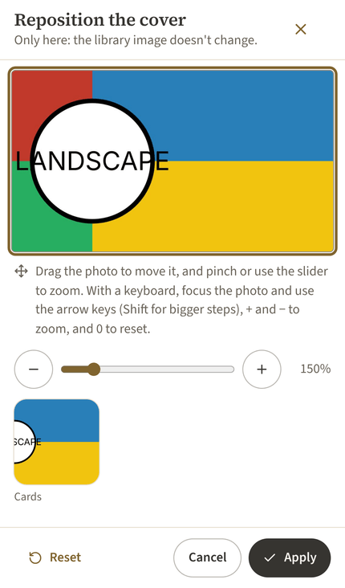 | 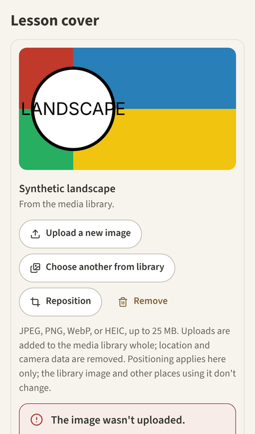 | 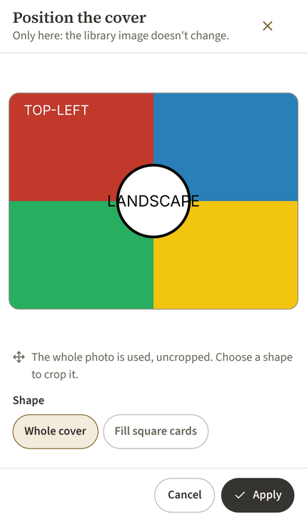 | 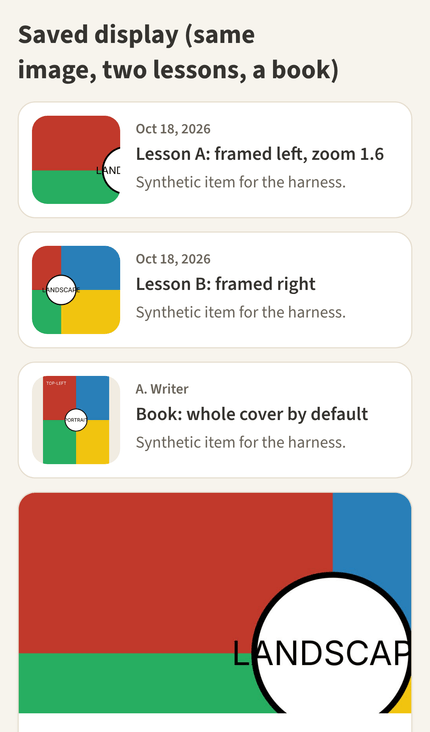 |

| Banner (phone and desktop frames) | Banner (dark) | Campaign image | Gallery rows |
| --- | --- | --- | --- |
| 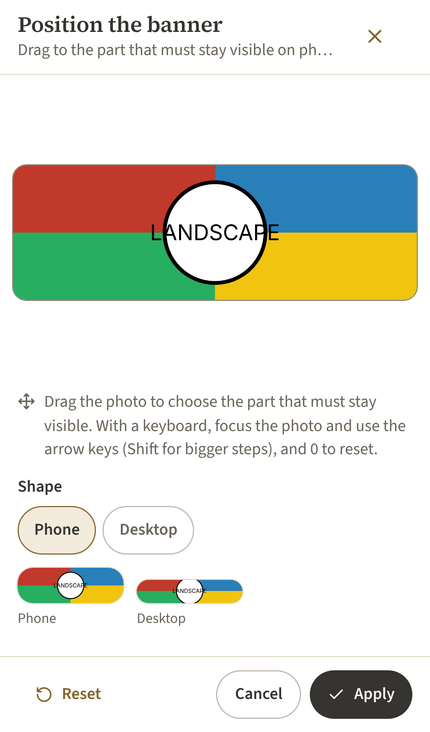 | 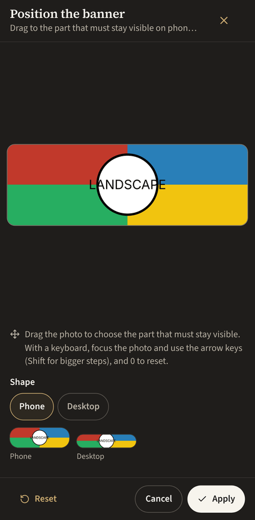 | 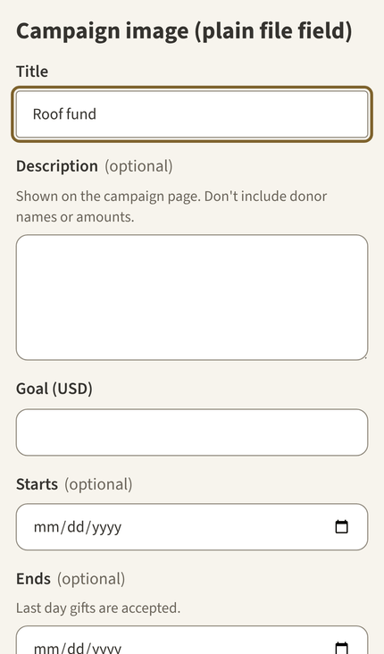 | 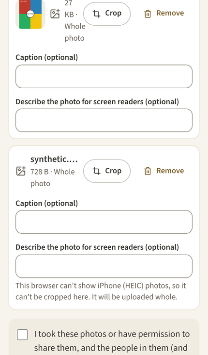 |

Desktop: [profile cropper](media-cropping/desktop-profile-cropper.png), [cover reposition](media-cropping/desktop-cover-reposition.png).

## 6. Release

1. Review and merge the pull request (not merged by Claude).
2. **Database:** the migration objects are on the hosted project and match the repository. To add the missing history row, run `supabase/manual/2026-11-10-record-media-cover-framing.sql` once in the SQL editor. It changes nothing else.
3. **Order:** the app can be deployed now. Covers stay centred until someone repositions them.
